<picture><source media="(prefers-color-scheme: dark)" srcset="assets/hero-dark.svg"></picture>

<a href="https://discord.com/users/betgetter"><picture><source media="(prefers-color-scheme: dark)" srcset="assets/social-1-dark.svg"></picture></a>&nbsp;<a href="mailto:contact@darrion.org"><picture><source media="(prefers-color-scheme: dark)" srcset="assets/social-2-dark.svg"></picture></a>&nbsp;<a href="https://steamcommunity.com/id/KushGuy"><picture><source media="(prefers-color-scheme: dark)" srcset="assets/social-3-dark.svg"></picture></a>&nbsp;<a href="https://darrion.org/"><picture><source media="(prefers-color-scheme: dark)" srcset="assets/social-4-dark.svg"></picture></a>

<picture><source media="(prefers-color-scheme: dark)" srcset="assets/stack-dark.svg"></picture>

<a href="https://github.com/larrythemobster/OmniStats"><picture><source media="(prefers-color-scheme: dark)" srcset="assets/project-omnistats-dark.svg"></picture></a>&nbsp;<a href="https://github.com/larrythemobster/oci-a1-provisioner"><picture><source media="(prefers-color-scheme: dark)" srcset="assets/project-oci-a1-provisioner-dark.svg"></picture></a>

<a href="https://github.com/larrythemobster/styx"><picture><source media="(prefers-color-scheme: dark)" srcset="assets/project-styx-dark.svg"></picture></a>&nbsp;<a href="https://github.com/larrythemobster/ObfuSQF-Remover"><picture><source media="(prefers-color-scheme: dark)" srcset="assets/project-obfusqf-remover-dark.svg"></picture></a>

